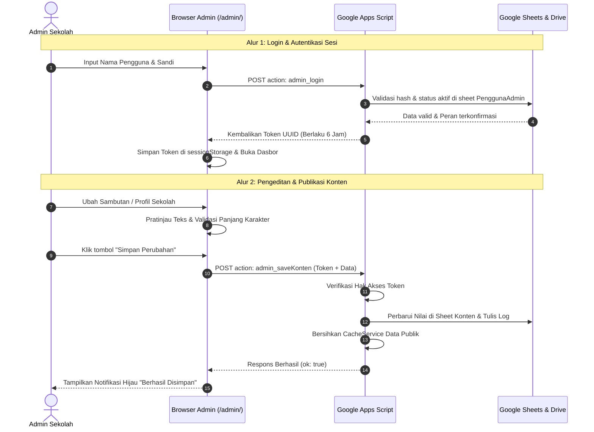

# PRD: Admin Panel & Content Management System (CMS) SD Negeri Sumberejo 04

**Versi Dokumen:** 1.0 (Final)  
**Status:** Disetujui untuk Tahap Pengembangan  
**Bahasa:** Bahasa Indonesia Baku  
**Sasaran Pembaca:** Pengelola Sekolah (Kepala Sekolah, Guru, Staf TU), Komite, dan Tim Pengembang  
**Dokumen Terkait:** `PRD.md` (v1.0), `API.md` (v1.0), `README.md` (v1.0), `CMS.md` (v1.0)

---

## 1. Ringkasan dan Tujuan CMS

Dokumen ini mendefinisikan kebutuhan produk untuk **Admin Panel / Content Management System (CMS)** situs web resmi SD Negeri Sumberejo 04. Sistem ini berfungsi sebagai pusat kendali mandiri bagi pihak sekolah untuk memperbarui seluruh informasi situs (profil, sambutan, pengumuman, guru, fasilitas, ekstrakurikuler, dan galeri), memantau serta memproses penerimaan murid baru (SPMB), dan mengunggah foto langsung dari perangkat (laptop maupun ponsel pintar).

Tujuan utama pembuatan CMS ini adalah:
1. **Kemandirian Pengelolaan:** Menghilangkan ketergantungan pihak sekolah kepada pengembang web setiap kali ada pembaruan data atau pengumuman rutin.
2. **Kemudahan Tanpa Teknis:** Menyediakan antarmuka web yang ramah bagi pengguna awam, sehingga pengelola sekolah tidak perlu lagi mengedit baris tabel Google Sheets secara manual yang berisiko merusak rumus atau struktur kolom.
3. **Efisiensi Nol Biaya Operasional:** Beroperasi di atas arsitektur nir-server (*serverless*) berbasis GitHub Pages, Google Apps Script (GAS), Google Sheets, dan Google Drive tanpa biaya langganan bulanan maupun sewa server khusus.
4. **Keamanan & Privasi Berlapis:** Menerapkan pembagian peran kerja yang ketat guna melindungi data pribadi calon peserta didik (NIK, nomor kontak, berkas KK dan Akta) dari akses yang tidak berwenang.

---

## 2. Latar Belakang dan Masalah yang Diselesaikan

Pada arsitektur awal, pembaruan konten situs web dilakukan langsung dengan membuka dan menyunting lembar kerja Google Sheets. Pendekatan tersebut menimbulkan sejumlah kendala serius di lapangan:

1. **Risiko Kerusakan Struktur Database:** Staf sekolah yang belum terbiasa dengan struktur data teknis kerap kali tidak sengaja menghapus nama kolom header, mengubah tipe data (misalnya angka NIK kehilangan angka 0 di depan), atau merusak relasi antar-baris.
2. **Keterbatasan Pengelolaan Media:** Unggah foto guru, fasilitas, dan kegiatan mengharuskan staf membuka Google Drive secara terpisah, mengatur hak akses publik berkas (*Anyone with the link: Viewer*), menyalin tautan ID, lalu menempelkannya ke Google Sheets. Alur ini rumit, memakan waktu, dan sering menghasilkan tautan foto yang rusak di situs publik.
3. **Ukuran Foto yang Membebani Pengunjung:** Foto yang diambil langsung dari kamera ponsel pintar masa kini memiliki ukuran berkas yang sangat besar (3 MB hingga 15 MB). Tanpa proses kompresi otomatis, pemuatan halaman web di ponsel calon orang tua murid menjadi sangat lambat dan boros kuota data.
4. **Ketidakjelasan Riwayat Perubahan:** Pengeditan bersama pada Google Sheets menyulitkan pelacakan mengenai siapa staf yang mengubah informasi tertentu dan kapan perubahan tersebut dilakukan.
5. **Kebocoran Akses Data Pribadi:** Memberikan akses tautan Google Sheets kepada editor konten berisiko membuka data privat pendaftar SPMB yang semestinya hanya boleh diakses oleh Panitia SPMB dan Kepala Sekolah.

CMS ini hadir untuk menyelesaikan seluruh permasalahan tersebut melalui antarmuka web satu pintu yang aman, mudah, dan terpadu.

---

## 3. Tujuan dan Metrik Keberhasilan

| Metrik Keberhasilan | Kondisi Awal (Tanpa CMS) | Target dengan CMS | Cara Pengukuran |
|---|---|---|---|
| **Waktu Pembaruan Teks** | 10 – 15 menit (buka Sheets, cari baris, salin nilai) | Di bawah **2 menit** | Pengujian langsung oleh staf guru non-teknis |
| **Waktu Unggah Foto Baru** | 15 – 20 menit (Drive, ubah izin, salin ID link) | Di bawah **1 menit** (unggah langsung dari HP) | Pengujian unggah foto guru dari ponsel |
| **Ketergantungan Pengembang** | 4 – 8 panggilan bantuan teknis per bulan | **0 panggilan** untuk perubahan konten rutin | Pencatatan tiket bantuan pengembang |
| **Kecepatan Muat Foto di Web** | 5 – 8 detik (foto mentah kamera 5 MB) | Di bawah **1,5 detik** (kompresi otomatis < 600 KB) | Pengujian Google Lighthouse di jaringan 4G |
| **Insiden Kebocoran Data NIK** | Rawan (karena akses sheet terbagi) | **Nol insiden** (hak akses tersekat per peran) | Audit berkala log aktivitas dan hak akses |
| **Kegagalan Format Berkas** | Sering terjadi (salah tempel URL Drive) | **0% kesalahan** (sistem memvalidasi tipe file) | Validasi otomatis pada formulir CMS |

---

## 4. Pengguna dan Persona

### 4.1 Persona 1: Suhartono, M.Pd. – Kepala Sekolah (Peran: Superadmin)
- **Karakteristik:** Memiliki wewenang manajerial tertinggi, mobilitas tinggi, menggunakan laptop di ruang kerja dan ponsel pintar saat dinas luar.
- **Kebutuhan:** Memantau dasbor rekapitulasi SPMB harian, menyunting sambutan kepala sekolah, mengelola akun staf admin, dan memeriksa rekam jejak log aktivitas sekolah.
- **Skenario Penggunaan Utama:** Masuk ke dasbor pada pagi hari, memeriksa jumlah pendaftar SPMB baru, mengunduh ringkasan laporan CSV untuk rapat dinas pendidikan, dan menonaktifkan akun staf yang telah berpindah tugas.

### 4.2 Persona 2: Ibu Endang, S.Pd. – Guru Pembina Humas (Peran: Editor Konten)
- **Karakteristik:** Berfokus pada publikasi kegiatan belajar mengajar, pengumuman sekolah, dokumentasi ekstrakurikuler, dan profil guru. Sering mengambil dokumentasi langsung menggunakan kamera ponsel.
- **Kebutuhan:** Menambah pengumuman libur sekolah, mengunggah foto kegiatan upacara atau pentas seni langsung dari galeri ponsel, dan memperbarui jadwal ekstrakurikuler.
- **Skenario Penggunaan Utama:** Memotret kegiatan Jumat Bersih menggunakan ponsel, membuka menu Galeri di CMS, mengunggah foto dengan kompresi otomatis, memberikan takarir (*caption*), lalu menerbitkannya ke situs web seketika.

### 4.3 Persona 3: Pak Wahyu, A.Md. – Staf Tata Usaha / Operator (Peran: Admin SPMB)
- **Karakteristik:** Bertanggung jawab atas urusan administrasi peserta didik baru, ketelitian data kependudukan (NIK, KK, Akta), dan pelayanan informasi orang tua.
- **Kebutuhan:** Memeriksa kelengkapan berkas fisik dan digital calon murid, mengubah status pendaftaran (diverifikasi / diterima / ditolak), memberikan catatan koreksi, serta mencetak rekap pendaftar.
- **Skenario Penggunaan Utama:** Membuka modul Pendaftar setiap pukul 13.00 WIB, mengunduh dokumen KK dan Akta pendaftar, mencocokkan NIK calon murid, menulis catatan verifikasi, dan memperbarui status berkas menjadi "Diterima".

---

## 5. Peran dan Matriks Hak Akses

Sistem membagi kewenangan pengguna ke dalam tiga peran terpisah secara tegas:

| Modul & Kemampuan | Superadmin | Editor Konten | Admin SPMB |
|---|:---:|:---:|:---:|
| **Login & Dasbor Ringkasan** | ✅ Akses Penuh | ✅ Akses Penuh | ✅ Akses Penuh |
| **Ubah Kata Sandi Akun Sendiri** | ✅ Akses Penuh | ✅ Akses Penuh | ✅ Akses Penuh |
| **Identitas Sekolah (Alamat, Telp, Peta)** | ✅ Akses Penuh | ✅ Akses Penuh | ❌ Tidak Ada |
| **Konten Halaman (Beranda, Profil, Sejarah)** | ✅ Akses Penuh | ✅ Akses Penuh | ❌ Tidak Ada |
| **Kelola Pengumuman (Tambah/Ubah/Hapus)** | ✅ Akses Penuh | ✅ Akses Penuh | ❌ Tidak Ada |
| **Kelola Guru & Tenaga Didik** | ✅ Akses Penuh | ✅ Akses Penuh | ❌ Tidak Ada |
| **Kelola Ekstrakurikuler & Fasilitas** | ✅ Akses Penuh | ✅ Akses Penuh | ❌ Tidak Ada |
| **Kelola Galeri & Pustaka Media** | ✅ Akses Penuh | ✅ Akses Penuh | ❌ Tidak Ada |
| **Konfigurasi Jadwal & Status Buka/Tutup SPMB** | ✅ Akses Penuh | ❌ Tidak Ada | ✅ Akses Penuh |
| **Lihat Daftar Pendaftar SPMB** | ✅ Akses Penuh | ❌ Tidak Ada | ✅ Akses Penuh |
| **Lihat Detail Privat (NIK Penuh, Link Berkas)** | ✅ Akses Penuh | ❌ Tidak Ada | ✅ Akses Penuh |
| **Ubah Status Pendaftar & Catatan Verifikasi** | ✅ Akses Penuh | ❌ Tidak Ada | ✅ Akses Penuh |
| **Ekspor Data Pendaftar ke File CSV** | ✅ Akses Penuh | ❌ Tidak Ada | ✅ Akses Penuh |
| **Manajemen Akun Admin (Tambah/Reset/Nonaktif)** | ✅ Akses Penuh | ❌ Tidak Ada | ❌ Tidak Ada |
| **Audit Log Aktivitas Sistem** | ✅ Akses Penuh | ❌ Tidak Ada | ❌ Tidak Ada |

*Catatan: Sistem menolak akses modul baik pada antarmuka visual (menu disembunyikan) maupun validasi keamanan di tingkat backend Google Apps Script.*

---

## 6. Ruang Lingkup

### 6.1 Ruang Lingkup MVP (Minimum Viable Product - Wajib)
Seluruh fungsionalitas yang tercakup pada rilis perdana CMS meliputi:
1. Otentikasi sesi mandiri berbasis token dengan masa kedaluwarsa otomatis (maksimal 6 jam).
2. Tiga peran pengguna (*Role-Based Access Control*): Superadmin, Editor Konten, dan Admin SPMB.
3. Dasbor operasional dengan kartu indikator pendaftar baru, status SPMB, dan peringatan kedaluwarsa jadwal.
4. Penyunting identitas sekolah, visi-misi, sejarah, sambutan kepala sekolah, dan peta embed.
5. Manajemen koleksi penuh (CRUD): Pengumuman, Guru, Ekstrakurikuler, Fasilitas, dan Galeri.
6. Unggah foto langsung dari kamera/penyimpanan perangkat dengan pemotongan (*crop*) dan kompresi kanvas di peramban.
7. Pustaka media terpusat (*Media Library*) untuk memilih kembali foto yang telah terunggah.
8. Modul verifikasi SPMB: tabel filter, modal rincian pendaftar, ubah status pendaftaran, catatan verifikator, dan unduh CSV.
9. Manajemen pengguna admin dan pencatatan riwayat audit (*audit log*) ke dalam sheet `Log`.
10. Mekanisme pembersihan cache publik seketika (*instant cache invalidation*) saat data disimpan di CMS.

### 6.2 Ruang Lingkup Fase 2 (Pengembangan Lanjutan)
1. Fitur cetak kartu tanda bukti pendaftaran SPMB langsung dalam format PDF dari sisi admin.
2. Statistik grafik visual interaktif untuk tren pendaftaran harian dan demografi asal sekolah TK/PAUD.
3. Integrasi bot pengingat notifikasi otomatis ke nomor WhatsApp orang tua saat status berkas diverifikasi.
4. Fitur pencadangan (*backup*) data spreadsheet otomatis sekali seminggu ke Google Drive terpisah.

### 6.3 Di Luar Lingkup (Out of Scope)
1. Editor teks format kaya (*WYSIWYG HTML*) dengan styling bebas yang berpotensi merusak tata letak responsif situs publik.
2. Fitur seret-dan-lepas (*drag and drop*) tata letak blok halaman situs.
3. Sistem pembayaran iuran atau transaksi keuangan perbankan daring.
4. Sistem informasi akademik harian (e-Rapor, presensi kelas harian siswa, jadwal pelajaran per kelas).
5. Integrasi langsung ke pangkalan data Kementerian/Dinas (DAPODIK / SIAP PPDB).

---

## 7. Kebutuhan Fungsional per Modul

### Modul C01: Login dan Manajemen Sesi
- **Deskripsi:** Pintu gerbang keamanan untuk memastikan hanya staf terdaftar yang dapat masuk ke panel CMS.
- **Kriteria Penerimaan (Dapat Diuji):**
  1. Halaman login menampilkan input nama pengguna, kata sandi, dan tombol "Masuk".
  2. Sistem menolak nama pengguna/kata sandi yang tidak cocok dengan pesan ramah: *"Nama pengguna atau kata sandi salah."*
  3. Sistem mengunci percobaan login selama 15 menit apabila terjadi kegagalan 5 kali berturut-turut pada akun yang sama.
  4. Token sesi berhasil dibuat dan disimpan di `sessionStorage` peramban saat autentikasi sukses.
  5. Sesi kedaluwarsa secara otomatis setelah 6 jam tidak aktif, dan pengguna dialihkan kembali ke layar login.
  6. Menekan tombol "Keluar" menghapus token di peramban dan mematikan token di backend GAS.

### Modul C02: Dasbor Operasional
- **Deskripsi:** Pusat ringkasan informasi terkini mengenai kondisi operasional sekolah dan pendaftaran.
- **Kriteria Penerimaan (Dapat Diuji):**
  1. Menampilkan jumlah pendaftar baru yang belum diverifikasi (status `baru`).
  2. Menampilkan jumlah total pendaftar pada periode berjalan.
  3. Menampilkan status SPMB saat ini (`buka` atau `tutup`) beserta tanggal penutupan pendaftaran.
  4. Menampilkan kartu peringatan merah jika tanggal hari ini telah melewati batas `spmbSelesai` namun status masih berstatus `buka`.
  5. Menampilkan jumlah artikel pengumuman yang sedang aktif tayang di situs web.

### Modul C03: Identitas Sekolah
- **Deskripsi:** Formulir penyuntingan data kelembagaan resmi sekolah.
- **Kriteria Penerimaan (Dapat Diuji):**
  1. Menyediakan isian untuk: Nama Sekolah, NPSN, Alamat Lengkap, Nomor Telepon, Nomor WhatsApp Informasi, Email Sekolah, Jam Operasional Layanan, Akreditasi, dan Tautan Embed Peta Google Maps.
  2. Nomor WhatsApp divalidasi harus berupa angka diawali format kode negara (misalnya `628...`).
  3. Tautan embed Google Maps divalidasi harus diawali dengan format URL yang sah (`https://...`).
  4. Perubahan yang disimpan langsung memperbarui data di sheet `Konten` dan tercermin di situs publik dalam waktu kurang dari 10 detik.

### Modul C04: Konten Halaman Beranda
- **Deskripsi:** Pengaturan teks sorotan dan pesan penyambutan pada muka situs web.
- **Kriteria Penerimaan (Dapat Diuji):**
  1. Menyediakan area teks untuk Sambutan Kepala Sekolah (mendukung format paragraf baru).
  2. Menyediakan input angka untuk statistik: Jumlah Siswa Aktif, Jumlah Guru & Tenaga Kependidikan, dan Persentase Kelulusan.
  3. Menyediakan pemilihan foto profil Kepala Sekolah dari Pustaka Media atau unggahan baru.
  4. Terdapat panel pratinjau teks sebelum admin menekan tombol simpan.

### Modul C05: Konten Halaman Profil Sekolah
- **Deskripsi:** Pengaturan sejarah sekolah, dokumen visi dan misi, serta struktur organisasi.
- **Kriteria Penerimaan (Dapat Diuji):**
  1. Bidang input teks sejarah sekolah mendukung pemisahan paragraf menggunakan baris kosong ganda.
  2. Bidang Visi Sekolah berupa teks tunggal yang jelas dan tegas.
  3. Bidang Misi Sekolah berupa format daftar poin (*bullet points*) yang dapat ditambah, dikurangi, atau diurutkan ulang barisnya.
  4. Memungkinkan pemilihan berkas gambar bagan struktur organisasi dari Pustaka Media.

### Modul C06: Konten & Pengaturan SPMB
- **Deskripsi:** Pengelolaan parameter pendaftaran peserta didik baru, jadwal, persyaratan, dan alur seleksi.
- **Kriteria Penerimaan (Dapat Diuji):**
  1. Sakelar (*switch toggle*) untuk membuka atau menutup status pendaftaran (`buka` / `tutup`).
  2. Pemilih tanggal mulai (`spmbMulai`) dan tanggal berakhir (`spmbSelesai`) dengan format standar YYYY-MM-DD.
  3. Kolom teks bebas untuk "Jadwal Gelombang Berikutnya" yang akan tayang otomatis saat pendaftaran berstatus tutup.
  4. Daftar poin persyaratan dokumen pendaftaran (KK, Akta, dll) yang dapat ditambah atau dihapus.
  5. Keterangan biaya pendaftaran (default: `Gratis (Bebas Biaya)`).

### Modul C07: Manajemen Pengumuman
- **Deskripsi:** Modul publikasi agenda, berita singkat, dan pemberitahuan resmi sekolah.
- **Kriteria Penerimaan (Dapat Diuji):**
  1. Tabel daftar memuat: Judul, Tanggal Publikasi, Status Tayang (`tampil`), dan Aksi.
  2. Formulir tambah/ubah memuat: Judul (maks 150 karakter), Tanggal, Isi Berita, dan Opsi Tayang di Beranda Utama (`tampilBeranda`).
  3. Tombol sakelar cepat untuk menyembunyikan pengumuman tanpa harus menghapus data dari baris basis data.
  4. Fitur hapus data disertai dialog konfirmasi keamanan: *"Apakah Anda yakin ingin menghapus pengumuman ini?"*.

### Modul C08: Manajemen Guru & Tenaga Kependidikan
- **Deskripsi:** Direktori dewan guru dan tenaga kependidikan sekolah.
- **Kriteria Penerimaan (Dapat Diuji):**
  1. Formulir memuat: Nama Lengkap beserta Gelar, Jabatan/Tugas Mengajar, Nomor Urutan Tampil, Foto Profil, dan Status Tampil.
  2. Foto guru dapat dipilih dari Pustaka Media atau difoto/diunggah langsung dari perangkat.
  3. Jika foto dikosongkan, sistem di situs publik secara otomatis menampilkan inisial nama berlatar belakang warna tema sekolah.
  4. Pengurutan kartu guru di situs publik presisi mengikuti nilai numerik pada kolom `urutan`.

### Modul C09: Manajemen Program & Ekstrakurikuler
- **Deskripsi:** Publikasi ragam kegiatan pengembangan bakat dan minat siswa.
- **Kriteria Penerimaan (Dapat Diuji):**
  1. Formulir memuat: Nama Kegiatan Ekstrakurikuler, Deskripsi Ringkas, Nama Pembina/Pelatih, Jadwal Latihan Mingguan, dan Foto Ilustrasi.
  2. Menyediakan tombol aktivasi untuk menyembunyikan ekskul yang sedang non-aktif sementara.

### Modul C10: Manajemen Fasilitas Sekolah
- **Deskripsi:** Dokumentasi sarana dan prasarana penunjang pembelajaran.
- **Kriteria Penerimaan (Dapat Diuji):**
  1. Formulir memuat: Nama Sarana/Ruangan, Deskripsi Keunggulan, Nomor Urut, Foto Fasilitas, dan Status Tampil.
  2. Mendukung penggantian foto fasilitas lama dengan foto terbaru berkualitas tinggi hasil kompresi peramban.

### Modul C11: Manajemen Galeri Dokumentasi
- **Deskripsi:** Arsip foto dan video dokumentasi kegiatan sekolah.
- **Kriteria Penerimaan (Dapat Diuji):**
  1. Mendukung dua tipe media: `foto` (berkas di Google Drive) atau `video` (tautan video YouTube sekolah).
  2. Menampilkan input Judul Dokumentasi, Tanggal Kegiatan, dan URL Media.
  3. Menampilkan pratinjau instan (*thumbnail*) berkas foto atau bingkai video YouTube pada formulir admin.

### Modul C12: Pustaka Media Terpusat (Media Library)
- **Deskripsi:** Gudang penyimpanan seluruh aset visual sekolah yang pernah diunggah.
- **Kriteria Penerimaan (Dapat Diuji):**
  1. Menampilkan kisi-kisi (*grid thumbnail*) seluruh foto yang tersimpan di sheet `Media` dan folder Drive `Konten Publik`.
  2. Dilengkapi kotak pencarian cepat berdasarkan teks alternatif (*alt text*) foto atau nama asli berkas.
  3. Tombol "Pilih Foto Ini" untuk langsung memasukkan URL foto ke formulir yang sedang aktif disunting.
  4. Tombol hapus media dinonaktifkan apabila foto tersebut sedang aktif dipakai di modul Guru, Fasilitas, Beranda, atau Galeri (terdapat keterangan lokasi penggunaan foto).

### Modul C13: Manajemen Pendaftar SPMB
- **Deskripsi:** Modul verifikasi berkas dan pemrosesan calon murid baru.
- **Kriteria Penerimaan (Dapat Diuji):**
  1. Tabel pendaftar memuat: Nomor Pendaftaran, Tanggal Masuk, Nama Lengkap Calon Murid, Asal TK, Status Berkas, dan Tombol Detail.
  2. Filter data berdasarkan: Status (`baru`, `diproses`, `diterima`, `ditolak`, `dibatalkan`) dan kolom pencarian teks (Nama atau NIK).
  3. Jendela modal rincian pendaftar menampilkan seluruh data formulir, termasuk tautan langsung pembuka berkas KK dan Akta di tab baru Google Drive.
  4. Formulir pengubahan status berkas dilengkapi kotak teks "Catatan Admin/Verifikator" (misalnya: *"Akta kelahiran buram, mohon kirim ulang via WA"*).
  5. Tombol "Ekspor Data (CSV)" menghasilkan berkas spreadsheet berformat CSV yang dapat diunduh langsung ke komputer untuk diserahkan ke Dinas Pendidikan.

### Modul C14: Manajemen Pengguna Admin
- **Deskripsi:** Pengelolaan hak akses akun staf sekolah (khusus peran Superadmin).
- **Kriteria Penerimaan (Dapat Diuji):**
  1. Menampilkan daftar pengguna terdaftar: Nama Pengguna, Nama Tampilan, Peran, Status Aktif, dan Tanggal Dibuat.
  2. Superadmin dapat menambah staf baru dengan menetapkan nama pengguna unik, kata sandi sementara, dan peran yang sesuai.
  3. Superadmin dapat menonaktifkan akun staf yang telah mutasi/pensiun.
  4. Superadmin dapat melakukan reset kata sandi staf dengan mengaktifkan tanda centang `wajibGantiSandi` saat login berikutnya.
  5. Sistem menolak perintah jika Superadmin mencoba menonaktifkan atau menghapus akun miliknya sendiri, serta menolak jika total Superadmin aktif tersisa 0.

### Modul C15: Audit Log Aktivitas Sistem
- **Deskripsi:** Rekam jejak kronologis setiap aksi perubahan data di dalam CMS.
- **Kriteria Penerimaan (Dapat Diuji):**
  1. Mencatat secara otomatis setiap aksi simpan, ubah status, hapus baris, dan login berhasil/gagal.
  2. Kolom rekam log mencakup: Waktu Kejadian (WIB), Nama Pengguna, Jenis Aksi, Nama Modul, ID Objek yang diubah, dan Ringkasan Keterangan.
  3. Data log bersifat *Read-Only* (hanya bisa dibaca oleh Superadmin) dan tidak dapat disunting maupun dihapus dari panel antarmuka CMS.

---

## 8. Alur Pengguna Utama (Step-by-Step)



### 8.1 Alur Login dan Pemulihan Sesi
1. Pengguna membuka alamat URL web admin: `https://[domain-sekolah]/admin/`.
2. Halaman memeriksa keberadaan token sesi aktif di `sessionStorage`:
   - Jika token valid ditemukan, peramban memanggil endpoint `admin_me` ke GAS untuk mengonfirmasi peran dan langsung menampilkan dasbor kerja.
   - Jika token tidak ada atau kedaluwarsa, layar menampilkan kartu formulir login.
3. Pengguna mengetik nama pengguna dan kata sandi, lalu menekan tombol **"Masuk ke Panel"**.
4. Sistem memverifikasi kredensial:
   - Jika salah: Pesan kesalahan ditampilkan, hitungan kegagalan bertambah.
   - Jika benar: Sistem menerbitkan token sesi acak (UUID), menyimpannya di `sessionStorage`, dan membuka menu kerja sesuai peran pengguna.

### 8.2 Alur Mengubah Sambutan Kepala Sekolah
1. Superadmin atau Editor Konten memilih menu **"Halaman Beranda"** pada bilah navigasi samping.
2. Pengguna menggulir ke bagian formulir **"Sambutan Kepala Sekolah"**.
3. Pengguna menyunting teks sambutan pada kotak teks area. Panel sebelah kanan secara otomatis menampilkan pratinjau tampilan format paragraf secara langsung (*live preview*).
4. Indikator status di pojok atas berubah menjadi kuning bertuliskan *"Ada perubahan yang belum disimpan"*.
5. Pengguna menekan tombol **"Simpan Sambutan"**.
6. Tombol berubah status menjadi non-aktif dengan animasi pemuatan (*Menyimpan...*).
7. GAS menerima permintaan, memvalidasi sesi editor, memperbarui baris `sambutanKepsek` di sheet `Konten`, mencatat riwayat ke sheet `Log`, dan menghapus memori *cache* publik.
8. Muncul notifikasi hijau di layar CMS: *"Sambutan Kepala Sekolah berhasil diperbarui dan telah tayang di situs publik."*

### 8.3 Alur Menambah Guru Baru Lengkap dengan Foto dari Ponsel
1. Editor Konten membuka menu **"Data Guru"** melalui peramban ponsel pintar.
2. Menekan tombol hijau bertuliskan **"+ Tambah Guru Baru"**.
3. Mengisi nama lengkap guru beserta gelar akademik (contoh: `Siti Aminah, S.Pd.`), jabatan (contoh: `Guru Kelas 1`), dan nomor urutan tampil.
4. Pada bagian foto profil, pengguna mengetuk area **"Pilih / Ambil Foto"**:
   - Pengguna memilih opsi kamera untuk memotret guru secara langsung, atau memilih dari galeri foto ponsel.
5. Peramban secara otomatis membaca berkas foto mentah (misal berukuran 8 MB), melakukan rotasi EXIF yang benar, dan mengompresnya di kanvas memori ponsel menjadi berkas JPEG beresolusi optimal dengan ukuran di bawah 500 KB.
6. Pratinjau foto langsung tampil di layar ponsel. Pengguna mengisi kotak teks alternatif: *"Foto resmi Ibu Siti Aminah"*.
7. Pengguna menekan tombol **"Simpan Data Guru"**.
8. Foto hasil kompresi dikirim ke GAS dalam format string base64, disimpan ke folder Google Drive `Konten Publik`, dan URL berkasnya otomatis ditautkan ke tabel data guru di Google Sheets.
9. Data guru baru seketika muncul pada daftar guru di CMS dan tampil di halaman `guru.html` situs web.

### 8.4 Alur Membuka atau Menutup Periode SPMB
1. Superadmin atau Admin SPMB mengklik menu **"Pengaturan SPMB"**.
2. Memeriksa tanggal pelaksanaan pendaftaran pada kalender `spmbMulai` dan `spmbSelesai`.
3. Menggeser sakelar status SPMB dari posisi **"Tutup"** ke posisi **"Buka"**.
4. Menekan tombol **"Perbarui Status SPMB"**.
5. Sistem memvalidasi tanggal: jika status diubah menjadi "Buka" namun tanggal penutupan telah terlewat di masa lampau, sistem memunculkan peringatan konfirmasi: *"Tanggal penutupan pendaftaran sudah terlewat. Apakah Anda ingin memperbarui tanggal penutupan terlebih dahulu?"*.
6. Setelah dikonfirmasi, status baru disimpan ke basis data, dan tombol pendaftaran online di situs publik seketika aktif melayani pengunjung.

### 8.5 Alur Memproses Pendaftar SPMB Baru
1. Admin SPMB masuk ke modul **"Data Pendaftar"**.
2. Memilih tab filter **"Pendaftar Baru"**.
3. Mengklik tombol **"Lihat Detail"** pada salah satu baris calon murid (misal: `SPMB-2027-0012` an. Ahmad Fauzi).
4. Layar modal rincian muncul menampilkan data lengkap calon murid, nama orang tua, alamat, dan nomor WhatsApp.
5. Admin mengklik tautan **"Berkas KK"** dan **"Berkas Akta"** yang terbuka pada tab peramban baru untuk memverifikasi keaslian dokumen.
6. Admin kembali ke tab CMS, mengubah dropdown status dari `baru` menjadi **`diterima`**.
7. Mengetikkan catatan verifikator pada kolom catatan admin: *"Dokumen lengkap dan memenuhi persyaratan zonasi usia 7 tahun."*
8. Mengklik tombol **"Simpan Verifikasi"**. Status pendaftar berhasil diperbarui di Google Sheets dan tersimpan aman.

---

## 9. Kebutuhan Unggah Foto dan Pemrosesan Media

```
Alur Pemrosesan Berkas Gambar:
Kamera / Galeri Perangkat (File Asli s.d. 15 MB)
  │
  ▼ (Client-side HTML5 Canvas API)
Rotasi Otomatis Berdasarkan EXIF Orientation
  │
  ▼
Penskalaan Dimensi (Maks Sisi Terpanjang: 1600 px / Hero: 2000 px)
  │
  ▼
Kompresi Kualitas JPEG (Target Ukuran: < 600 KB, Maksimum: 1,5 MB)
  │
  ▼ (Kirim via POST Base64)
Google Apps Script (Validasi Magic Bytes: FF D8 FF / 89 50 4E 47 / RIFF)
  │
  ▼
Penyimpanan ke Folder Drive "Konten Publik" + Catat Metadata ke Sheet "Media"
```

| Parameter | Ketentuan Teknis | Keterangan |
|---|---|---|
| **Format Masukan Diterima** | JPEG (`.jpg`, `.jpeg`), PNG (`.png`), WebP (`.webp`), HEIC/HEIF | HEIC dikonversi peramban (iOS Safari) menjadi JPEG secara otomatis. |
| **Batas Ukuran Berkas Awal** | Maksimal **15 MB** per berkas | Mencegah peramban ponsel kehabisan memori RAM saat memuat berkas mentah. |
| **Dimensi Maksimum Gambar** | 1600 piksel (sisi terpanjang) | Khusus foto latar belakang utama (*Hero Beranda*) batas maksimum 2000 piksel. |
| **Format Berkas Keluaran** | JPEG Kualitas 0.8 (*Quality Index*) | Berkas PNG dengan transparansi otomatis diberi latar belakang kanvas putih. |
| **Target Ukuran Berkas Akhir** | **Di bawah 600 KB** (Maksimal 1,5 MB) | Jika ukuran masih > 600 KB, peramban menurunkan kualitas secara bertahap hingga 0.6. |
| **Validasi Magic Bytes (GAS)** | Verifikasi *byte* pembuka berkas asli | JPEG: `FF D8 FF`<br>PNG: `89 50 4E 47`<br>WebP: `52 49 46 46`...`57 45 42 50`<br>Ekstensi palsu ditolak otomatis. |
| **Penyimpanan di Google Drive** | Folder `Konten Publik` | Hak akses berkas: *"Anyone with the link: Viewer"*. Berkas tidak pernah masuk ke folder privat SPMB. |
| **Format URL Tampilan Situs** | `https://lh3.googleusercontent.com/d/{fileId}` | Tautan CDN resmi Google yang cepat dan stabil untuk tag elemen `` HTML. |
| **Penanganan Kegagalan** | Isolasi error dan pesan informatif | Jika kompresi gagal, CMS menampilkan peringatan: *"Format berkas tidak didukung atau memori peramban penuh. Harap pilih foto lain."* |

---

## 10. Kebutuhan Non-Fungsional

### 10.1 Keamanan Sistem (Security)
1. **Penyimpanan Kata Sandi:** Kata sandi staf TIDAK PERNAH disimpan dalam format teks polos (*plaintext*). Sistem menggunakan algoritma pembangkit hash SHA-256 berkunci (*HMAC*) dengan *salt* acak unik 16-byte untuk setiap pengguna dan diulang sebanyak 1.000 kali iterasi. Format penyimpanan di sheet `PenggunaAdmin`: `salt$hash`.
2. **Proteksi Serangan Kamus (*Brute Force*):** Kegagalan autentikasi login sebanyak 5 kali berturut-turut pada nama pengguna yang sama memicu penguncian akun selama 15 menit menggunakan `CacheService`. Pesan kegagalan dibuat seragam tanpa membedakan apakah nama pengguna terdaftar atau tidak.
3. **Penyimpanan Token di Sisi Klien:** Token sesi hanya disimpan di dalam `sessionStorage` peramban (bukan `localStorage`), sehingga token otomatis terhapus seketika saat jendela peramban atau tab ditutup.
4. **Pencegahan Injeksi Kode (*XSS Prevention*):** Seluruh input teks yang dimasukkan melalui CMS disanitasi dari tag HTML berbahaya (seperti `<script>`, `<iframe>`, `onload=`). Seluruh teks yang dikirimkan ke situs publik di-escape dan dirender sebagai teks biasa.
5. **Pemisahan Jalur Publik dan Privat:** Basis data publik hanya membaca data dari sheet `Konten`, `Pengumuman`, `Guru`, `Ekstrakurikuler`, `Fasilitas`, dan `Galeri`. Sheet privat (`Pendaftar`, `PenggunaAdmin`, dan `Log`) sama sekali tidak memiliki endpoint akses baca publik.

### 10.2 Kinerja dan Kecepatan (Performance)
1. **Waktu Respons Simpan Konten:** Operasi penyimpanan data teks dari CMS hingga database terbarui harus selesai dalam waktu kurang dari 3 detik pada kondisi jaringan 4G stabil.
2. **Pembersihan Cache Instan:** Penyimpanan konten di CMS memicu pembersihan cache publik seketika (`CacheService.removeAll()`), memastikan perubahan langsung tampil di situs web publik dalam waktu maksimal 10 detik.
3. **Efisiensi Beban Payload:** Kompresi foto di sisi klien (*client-side*) mengurangi konsumsi kuota unggah internet admin hingga lebih dari 90%.

### 10.3 Responsivitas Perangkat Seluler (Mobile-First)
1. Seluruh antarmuka admin panel wajib dapat dioperasikan dengan lancar pada layar ponsel pintar dengan lebar resolusi mulai dari **360 piksel** ke atas.
2. Pada tampilan ponsel, bilah navigasi samping (*sidebar*) otomatis bertransformasi menjadi menu hamburger yang ringkas.
3. Tabel data pendaftar yang memiliki banyak kolom otomatis beralih menjadi format kartu informasi vertikal (*stacked cards*) saat diakses melalui layar sentuh ponsel.

### 10.4 Aksesibilitas dan Komunikasi Bahasa (Accessibility & Localization)
1. **Kontras Warna & Tipografi:** Mengikuti pedoman kepatuhan WCAG 2.1 AA dengan ukuran teks isi formulir minimal 16 piksel untuk mencegah pembesaran otomatis (*auto-zoom*) pada iPhone.
2. **Bahasa Antarmuka:** 100% menggunakan Bahasa Indonesia yang komunikatif, baku, santun, dan bebas dari jargon teknis pemrograman yang membingungkan staf sekolah.
3. **Format Pesan Kesalahan:** Pesan galat disusun secara manusiawi dengan petunjuk penyelesaian yang jelas, contoh:  
   - ❌ *Bukan:* `Error 422: Unprocessable Entity in regex field NIK`  
   - ✅ *Tetapi:* `Nomor NIK harus terdiri tepat 16 digit angka sesuai Kartu Keluarga.`

---

## 11. Batasan Teknis Google Apps Script & Dampak pada Desain

| Batasan Teknis GAS | Kapasitas Akun Standar | Dampak & Solusi Desain CMS |
|---|---|---|
| **Batas Waktu Eksekusi Maksimal** | 6 menit per satu kali eksekusi | Operasi batch penyimpanan konten dirancang per modul. Tidak menggabungkan unggah banyak foto dalam satu permintaan tunggal. |
| **Batas Ukuran Payload Permintaan** | Maksimal 2 MB per HTTP POST | Foto wajib dikompresi di peramban menjadi < 600 KB sebelum dikonversi ke string Base64 dan dikirim ke server. |
| **Masa Berlaku CacheService** | Maksimal 21.600 detik (6 jam) | Masa hidup token sesi login ditetapkan tepat 6 jam. Setelah 6 jam, pengguna diwajibkan login ulang demi keamanan data. |
| **Batas Kuota Pengiriman Email** | 100 email penerima per hari | Notifikasi email hanya dipicu untuk pendaftaran murid baru SPMB yang masuk, bukan pada setiap aktivitas pengeditan teks CMS. |
| **Batas Permintaan Simultan Drive/Sheets** | Pembatasan frekuensi (*Rate Limits*) | Menggunakan mekanisme kunci transaksi `LockService.getScriptLock()` dengan toleransi antrean maksimal 30 detik pada saat penyimpanan data. |

---

## 12. Perubahan yang Diperlukan pada Dokumen Terkait

Implementasi Admin Panel (CMS) ini memerlukan pembaruan sinkronisasi pada dokumen proyek terdahulu:

### 12.1 Perubahan pada `PRD.md` (Pembaruan ke Versi 1.1)
- [ ] **Bagian 6.1 (Ruang Lingkup MVP):** Menambahkan fitur `F11: Admin Panel (CMS)` ke dalam daftar kapabilitas wajib MVP.
- [ ] **Bagian 6.1 & 7:** Memindahkan modul `Galeri` dari Fase 2 menjadi bagian dari MVP, memanfaatkan pustaka media CMS.
- [ ] **Bagian 7 (Struktur Halaman Web):** Menambahkan direktori berkas `/admin/` (terisolasi dan berstatus `noindex`).
- [ ] **Bagian 10 (Non-Fungsional):** Menambahkan klausul keamanan otentikasi login multi-peran dan batasan unggah foto 1,5 MB.

### 12.2 Perubahan pada `API.md` (Pembaruan ke Versi 1.1)
- [ ] **Bagian 3 (Spesifikasi Endpoint):** Mendaftarkan 17 aksi (*action*) endpoint baru khusus admin (`admin_login`, `admin_saveKonten`, `admin_uploadMedia`, `admin_listPendaftar`, dll).
- [ ] **Bagian 3.1:** Menambahkan endpoint efisiensi publik `getSiteBundle` untuk mengambil seluruh konten web dalam satu kali pemanggilan tunggal.
- [ ] **Bagian 4 (Desain Tabel Sheets):** Menambahkan struktur skema sheet baru: `Konten`, `PenggunaAdmin`, `Media`, dan `Log`.
- [ ] **Bagian 8 (Autentikasi):** Mengganti skema token statis tunggal menjadi verifikasi token sesi terenkripsi berbasis peran.

### 12.3 Perubahan pada `README.md` (Pembaruan ke Versi 1.1)
- [ ] **Bagian 1 (Struktur Folder Repositori):** Memasukkan folder `/admin/` yang berisi `index.html`, `admin.css`, `admin.js`, dan `image.js`.
- [ ] **Bagian 5A (Inisialisasi Superadmin Pertama):** Menambahkan panduan pembuatan akun Superadmin awal melalui eksekusi fungsi skrip khusus `setupSuperadminAwal()`.
- [ ] **Bagian 9 (Panduan Pengelola Sekolah):** Mengubah panduan operasional sekolah dari instruksi *"Edit Google Sheets"* menjadi *"Edit via Antarmuka Panel Web di /admin/"*.

---

## 13. Analisis Risiko dan Mitigasi

| No | Identifikasi Risiko | Tingkat Dampak | Probabilitas | Rencana Mitigasi Pencegahan |
|---|---|:---:|:---:|---|
| R1 | Pengguna lupa kata sandi dan seluruh Superadmin terkunci | Tinggi | Rendah | Menyediakan fungsi skrip darurat (*break-glass*) `resetSuperadminDarurat()` di editor GAS yang hanya bisa dijalankan oleh pemegang akun Google resmi sekolah. |
| R2 | Memori peramban ponsel lawas macet saat kompresi foto resolusi tinggi | Sedang | Sedang | Menerapkan batas ukuran awal 15 MB, validasi memori bertahap, dan pesan peringatan ramah jika kanvas gagal memproses gambar. |
| R3 | Data publik di situs web tidak langsung berubah setelah disimpan | Sedang | Rendah | Mengintegrasikan pembersihan cache otomatis di GAS setiap kali fungsi `admin_saveKonten` atau `admin_saveRows` berhasil dieksekusi. |
| R4 | URL admin panel `/admin/` terindeks oleh mesin pencari Google | Rendah | Sedang | Memasang tag `<meta name="robots" content="noindex, nofollow">` dan konfigurasi berkas `robots.txt` (`Disallow: /admin/`). |
| R5 | Kuota Google Apps Script terlampaui saat periode puncak SPMB | Tinggi | Rendah | Mengoptimalkan pemanggilan frontend publik menggunakan bundle tunggal (`getSiteBundle`) dengan masa cache 5 menit untuk pengunjung biasa. |
| R6 | Akun staf yang berpindah tugas disalahgunakan pihak lain | Tinggi | Sedang | Kebijakan rotasi akun, pencatatan log IP/waktu setiap sesi, dan tombol penonaktifan akun satu klik oleh Kepala Sekolah. |

---

## 14. Rencana Rilis Bertahap

Pengerjaan CMS dibagi ke dalam 6 tahapan terstruktur:

```
Tahap 1: Fondasi Keamanan & Sesi (Sheet PenggunaAdmin, Hash Salt, Login, Logout)
  │
  ▼
Tahap 2: Manajemen Konten Teks (Sheet Konten, Form Identitas, Beranda, Profil, getSiteBundle)
  │
  ▼
Tahap 3: Manajemen Koleksi Data (CRUD Pengumuman, Guru, Ekskul, Fasilitas, Galeri)
  │
  ▼
Tahap 4: Sistem Unggah & Pustaka Media (Kompresi Canvas, Unggah Drive, Sheet Media)
  │
  ▼
Tahap 5: Modul Verifikasi SPMB (Filter Status, Detail Privat, Catatan Admin, Ekspor CSV)
  │
  ▼
Tahap 6: Pengujian Hak Akses, Audit Log, Dokumentasi & Pelatihan Staf Sekolah
```

1. **Tahap 1: Fondasi Keamanan & Manajemen Sesi**
   - Pembuatan sheet `PenggunaAdmin`, logika hash HMAC-SHA-256, mekanisme sesi `CacheService`, antarmuka login, dan pembagian hak akses per peran.
2. **Tahap 2: Manajemen Konten Teks & Bundle Publik**
   - Pembuatan sheet `Konten`, formulir penyunting teks (Identitas, Beranda, Profil, SPMB), dan integrasi endpoint hemat kuota `getSiteBundle`.
3. **Tahap 3: Manajemen Koleksi Data Dinamis**
   - Pengembangan antarmuka pengelolaan tabel Pengumuman, Guru, Ekstrakurikuler, Fasilitas, dan Galeri.
4. **Tahap 4: Mesin Pemrosesan Media & Pustaka Gambar**
   - Pembuatan pustaka `image.js` untuk kompresi di peramban, integrasi unggah ke folder Drive `Konten Publik`, dan antarmuka penjelajah media.
5. **Tahap 5: Modul Manajemen Verifikasi SPMB**
   - Pengembangan tabel pendaftar, pembaca berkas privat Drive, pengubah status pendaftaran, catatan verifikator, dan fungsi unduh berkas CSV.
6. **Tahap 6: Manajemen Pengguna, Audit Log, dan Pelatihan**
   - Antarmuka kelola pengguna, peninjau sheet `Log`, uji coba simulasi dengan staf guru, dan serah terima dokumen operasional.

---

## 15. Daftar Asumsi

1. **Infrastruktur Akun:** Pihak sekolah memiliki dan mengelola satu akun Google resmi kelembagaan (bukan akun pribadi guru) yang digunakan sebagai pemilik Google Spreadsheet, Google Drive, dan Google Apps Script.
2. **Konektivitas Internet:** Staf sekolah yang mengoperasikan CMS memiliki koneksi internet yang memadai (kecepatan unduh/unggah minimal 2 Mbps) melalui jaringan Wi-Fi sekolah atau paket data seluler 4G/5G.
3. **Kompatibilitas Peramban:** Staf sekolah menggunakan peramban web modern yang mendukung standar HTML5 Canvas, ECMAScript 6, dan Fetch API (Google Chrome versi 90+, Mozilla Firefox versi 90+, Microsoft Edge versi 90+, atau Safari iOS versi 14+).
4. **Volume Transaksi Data:** Estimasi jumlah pendaftar SPMB per tahun ajaran baru berada di bawah 300 pendaftar, dan jumlah artikel pengumuman berkisar antara 10 hingga 50 publikasi per tahun.

---

## 16. Pertanyaan Terbuka untuk Pihak Sekolah

Hal-hal berikut perlu dikonfirmasikan bersama pihak Kepala Sekolah dan Operator SD Negeri Sumberejo 04 sebelum rilis produksi:

1. **Penetapan Staf Pengelola Awal:** Siapa nama lengkap dan alamat email resmi yang akan didaftarkan sebagai Superadmin perdana, Editor Konten humas, dan Panitia Verifikator SPMB?
2. **Kebijakan Publikasi Foto Siswa:** Apakah sekolah telah memiliki surat persetujuan tertulis (*media consent*) dari orang tua murid untuk menampilkan foto dokumentasi kegiatan siswa di situs publik?
3. **Format Laporan Dinas Pendidikan:** Apakah dinas pendidikan setempat mewajibkan format urutan kolom tertentu dalam ekspor berkas data pendaftar SPMB (CSV/Excel)?
4. **Mekanisme Reset Akun:** Apakah Kepala Sekolah menghendaki notifikasi email otomatis dikirimkan ke alamat email pribadi Kepala Sekolah setiap kali terjadi aksi reset kata sandi atau pergantian Superadmin?

---

## 17. Daftar Perubahan Dokumen (Changelog)

| Versi | Tanggal | Penulis | Deskripsi Ringkasan Perubahan |
|:---:|:---:|---|---|
| **1.0** | 29 Oktober 2026 | Tim Arsitek Sistem & Product Manager | Rilis dokumen final PRD Admin Panel (CMS) SD Negeri Sumberejo 04, merangkum spesifikasi login, hak akses multi-peran, editor konten dinamis, kompresi media di sisi peramban, operasional SPMB, dan audit log. |
